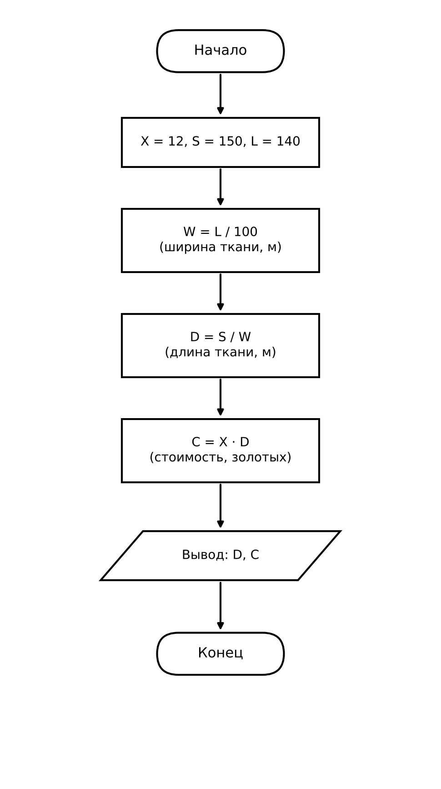

Домашнее задание к работе 2

## Условие задачи

Стоимость погонного метра красного шелка стоит **X** золотых. Сколько заплатил Грей за ткань для своей бригантины, если общая площадь парусов на ней **S** м², а ширина ткани в рулоне **L** см.

Для расчёта заданы значения: **X = 12** золотых, **S = 150** м², **L = 140** см.

* * *

## 1. Алгоритм и блок-схема

### Алгоритм

1. Задать значения: стоимость погонного метра `X = 12` золотых, площадь парусов `S = 150` м², ширина ткани в рулоне `L = 140` см.
2. Перевести ширину ткани в метры: `W = L / 100`.
3. Вычислить необходимую длину ткани: `D = S / W`.
4. Вычислить стоимость ткани: `C = X × D`.
5. Вывести исходные данные, промежуточные расчёты и итоговую стоимость.
6. Завершить программу.

### Блок-схема



* * *

## 2. Реализация программы

```c
#include <stdio.h>
#include <locale.h>

int main() {
    double X = 12, S = 150, L = 140;
    double W, D, C;

    setlocale(LC_ALL, "Russian");

    W = L / 100;
    D = S / W;
    C = X * D;

    printf("РАСЧЕТ СТОИМОСТИ ШЕЛКА ДЛЯ БРИГАНТИНЫ\n");
    printf("================================\n\n");
    printf("УСЛОВИЯ:\n");
    printf("- Стоимость погонного метра красного шелка: %.0f золотых.\n", X);
    printf("- Общая площадь парусов: %.0f м2.\n", S);
    printf("- Ширина ткани в рулоне: %.0f см.\n\n", L);
    printf("РАСЧЕТ:\n");
    printf("- Ширина ткани в метрах: %.0f см / 100 = %.2f м.\n", L, W);
    printf("- Длина ткани: %.0f м2 / %.2f м = %.4f м.\n", S, W, D);
    printf("- Стоимость: %.4f м * %.0f золотых/м = %.2f золотых.\n", D, X, C);
    printf("================================\n");
    printf("ГРЕЙ ЗАПЛАТИЛ ЗА ТКАНЬ: %.2f золотых\n", C);
    return 0;
}
```

* * *

## 3. Результаты работы программы

Пример работы программы при X = 12 золотых, S = 150 м², L = 140 см:

```
РАСЧЕТ СТОИМОСТИ ШЕЛКА ДЛЯ БРИГАНТИНЫ
================================

УСЛОВИЯ:
- Стоимость погонного метра красного шелка: 12 золотых.
- Общая площадь парусов: 150 м2.
- Ширина ткани в рулоне: 140 см.

РАСЧЕТ:
- Ширина ткани в метрах: 140 см / 100 = 1.40 м.
- Длина ткани: 150 м2 / 1.40 м = 107.1429 м.
- Стоимость: 107.1429 м * 12 золотых/м = 1285.71 золотых.
================================
ГРЕЙ ЗАПЛАТИЛ ЗА ТКАНЬ: 1285.71 золотых
```

* * *

## 4. Информация о разработчике

- **ФИО:Гуменников Степан Станиславович**
- **Группа:БОТИ-262**
